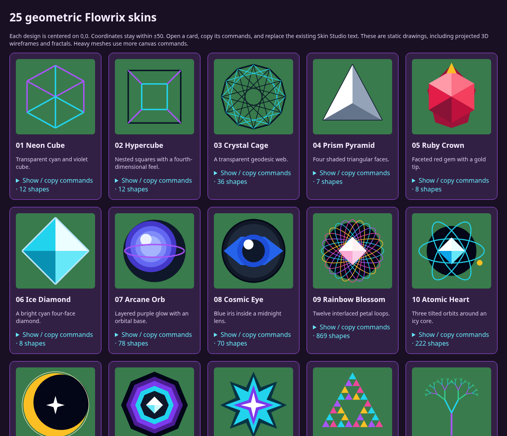

# 25 Flowrix skin designs

Open index.html in a browser for the preview gallery. Each .txt file contains commands to paste into Skin Studio. Replace existing commands instead of appending. All coordinates are centered on 0,0 within ±50; stroke widths add a small outer edge. Rainbow Blossom is the heaviest design (869 commands); Wireframe Torus uses 400. Designs are static; 3D appearance comes from projection and shading. The previews use the same coordinates and colors, rendered through SVG. Actual game rendering may differ.

- [01 Neon Cube](01-neon-cube.txt)
- [02 Hypercube](02-hypercube.txt)
- [03 Crystal Cage](03-crystal-cage.txt)
- [04 Prism Pyramid](04-prism-pyramid.txt)
- [05 Ruby Crown](05-ruby-crown.txt)
- [06 Ice Diamond](06-ice-diamond.txt)
- [07 Arcane Orb](07-arcane-orb.txt)
- [08 Cosmic Eye](08-cosmic-eye.txt)
- [09 Rainbow Blossom](09-rainbow-blossom.txt)
- [10 Atomic Heart](10-atomic-heart.txt)
- [11 Golden Eclipse](11-golden-eclipse.txt)
- [12 Octagon Portal](12-octagon-portal.txt)
- [13 Star Engine](13-star-engine.txt)
- [14 Fractal Triangle](14-fractal-triangle.txt)
- [15 Crystal Tree](15-crystal-tree.txt)
- [16 Square Vortex](16-square-vortex.txt)
- [17 Neon Moth](17-neon-moth.txt)
- [18 Spectrum Wheel](18-spectrum-wheel.txt)
- [19 Black Hole](19-black-hole.txt)
- [20 Wireframe Torus](20-wireframe-torus.txt)
- [21 Star Constellation](21-star-constellation.txt)
- [22 Sunflower Shield](22-sunflower-shield.txt)
- [23 Quantum Hourglass](23-quantum-hourglass.txt)
- [24 Puzzle Cube](24-puzzle-cube.txt)
- [25 Crystal Lotus](25-crystal-lotus.txt)
